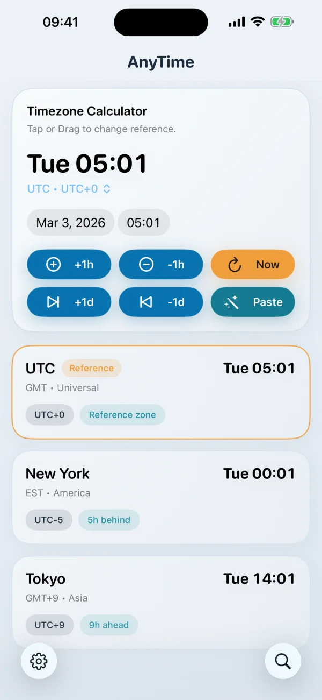
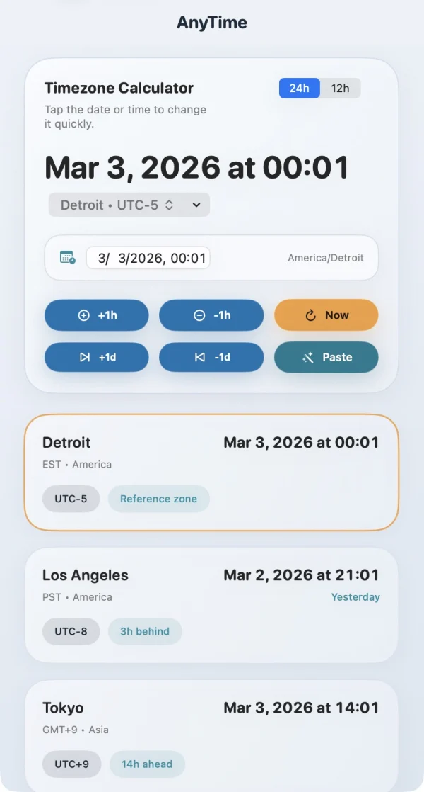
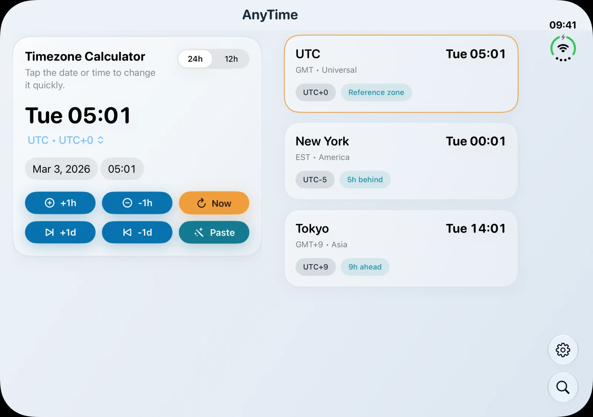

# AnyTime

[](https://github.com/hewigovens/anytime/actions/workflows/ci.yml)
[](https://apps.apple.com/us/app/anytime-timezone-calculator/id1291735859)
[](https://apps.apple.com/us/app/anytime-timezone-calculator/id1291735859)
[](LICENSE)

A focused world clock and timezone calculator for **iPhone, iPad, and Mac**.
Pick a reference city, adjust the time, and see every saved clock update together.
Plan a call, check a deadline, or find a time that works across cities.

<a href="https://apps.apple.com/us/app/anytime-timezone-calculator/id1291735859">
  
</a>

Requires iOS / iPadOS 17 or later, or macOS 14 or later.

## Features

- **Compare cities instantly.** Search by city, region, timezone abbreviation, or UTC offset.
- **Explore another time.** Edit the reference date and time, jump by an hour or a day, or return to now.
- **Paste a meeting time.** Extract date and timezone hints from text copied from a message, email, or webpage.
- **Add it to your calendar.** Create an event from the time you are comparing.
- **Make it yours.** Reorder clocks, choose city or timezone labels, switch between 12-hour and 24-hour formats, and optionally use your current location's timezone.
- **Use the space you have.** Single-column layouts on smaller screens, a pinned calculator beside your clocks on wider screens, and hinge-aware layouts on iPhone Duo. Supports light and dark appearance.

## Screenshots

| iPhone | macOS |
| :---: | :---: |
|  |  |

### iPhone Duo

The wider display keeps the reference calculator visible while your clocks scroll alongside it.



## Install with Homebrew

Prefer Homebrew on your Mac?

```bash
brew tap hewigovens/tap
brew install --cask anytime
```

## Contributing

Built with Swift and SwiftUI, with shared timezone search, persistence, and presentation logic in [`AnyTimeCore`](Packages/AnyTimeCore).
See [CONTRIBUTING.md](CONTRIBUTING.md) for setup, build commands, tests, and release tooling.

Found a bug or have an idea? [Open an issue](https://github.com/hewigovens/anytime/issues).

## License

BSL 1.1 — free to use, modify, and redistribute; paid app store distribution requires permission. Converts to Apache-2.0 on 2030-03-23. See [LICENSE](LICENSE).
